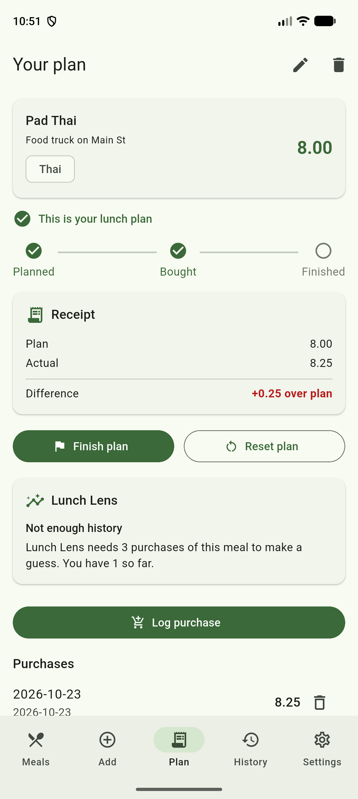
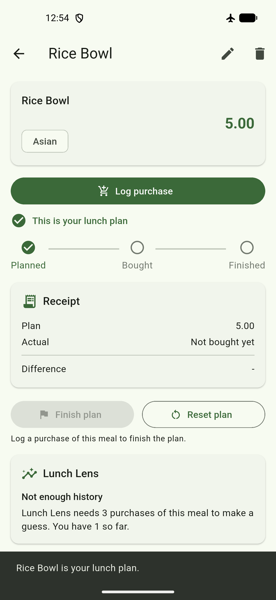
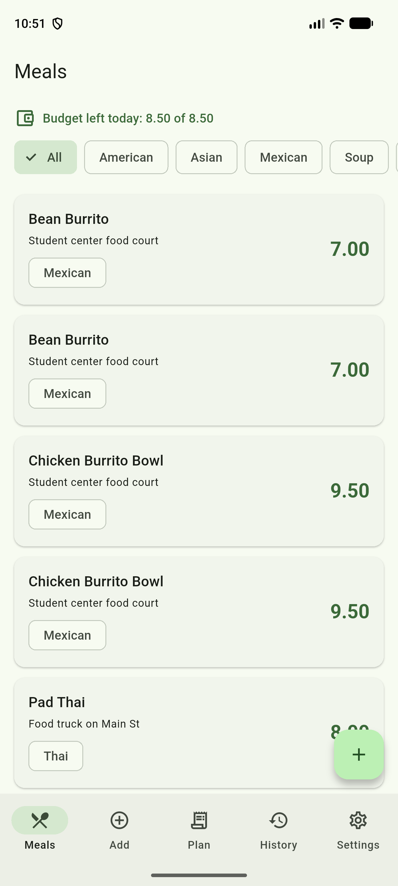
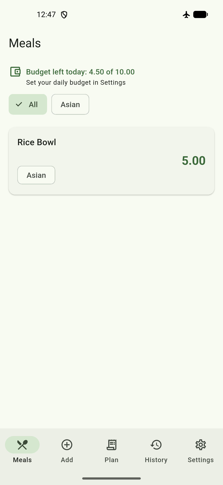

# Design Review and Change

**Date:** October 25, 2026
**Reviewer:** Uyiosa Nehikhuere (self-review)
**Commit:** [`fda8bd6`](https://github.com/Icecoldblack/MAD-Budget-Bites/commit/fda8bd6)

## Why a self-review

Budget Bites is a one-person project. The proposal planned for a peer to
test the design. No peer tester was available, so the instructor agreed
that a self-review was acceptable for this team.

The review was done by using the app on an emulator and going through the
four checks from the proposal:

1. Add a meal and log a purchase.
2. Find the total for a period.
3. Enter a bad price.
4. Read the Lunch Lens card.

## What was found and changed

| # | Problem found | Change made |
|---|---|---|
| 1 | On a planned meal, the progress row, receipt, plan buttons, and Lunch Lens card pushed **Log purchase** near the bottom of the screen. The main action was hard to reach. | Moved **Log purchase** to right under the meal card. |
| 2 | The **Add** tab and the **+** button on the Meals screen did the same thing. A new user might not know which one to use. | Removed the **+** button. The **Add** tab is the one way to add a meal. |
| 3 | "Moving average" on the Lunch Lens card is jargon. Check 4 asks whether a user understands the card. | Changed the text to "Average of your last 3 purchases:". |
| 4 | The bad-price message, "Enter a price like 6.50 (zero or more, up to 2 decimals).", was long and easy to skim past. | Shortened it to "Enter a price like 6.50". |
| 5 | Nothing on the Meals screen said where "Budget left today" comes from. | Added "Set your daily budget in Settings" under it. |

A small layout fix was also made: with only a few cuisines, the filter
chips were centered on the screen. They now start on the left.

## Main change: Log purchase moved up

Change 1 is the one to link on the ClickUp board for Task 5.

| Before | After |
|---|---|
|  |  |
| Log purchase sits below the receipt, plan buttons, and Lunch Lens. | Log purchase sits right under the meal card. |

The "before" screenshot was taken on the Pixel 9 Pro XL emulator and the
"after" screenshot on the Pixel 5 emulator.

Meals screen, before and after changes 2 and 5:

| Before | After |
|---|---|
|  |  |

## How the change was checked

- All 108 automated tests pass.
- `test/ui_changes_test.dart` checks that:
  - the Meals screen has no **+** button,
  - the "Set your daily budget in Settings" line shows,
  - **Log purchase** is above the receipt on a planned meal.
- The new build was checked by hand on the Pixel 5 emulator.

## Sketch

To do: update the Screen 1 (Catalog) and Screen 3 (Detail and Plan)
wireframes to match. Remove the **+** button from the Catalog, and place
**Log purchase** under the meal card on Detail.
